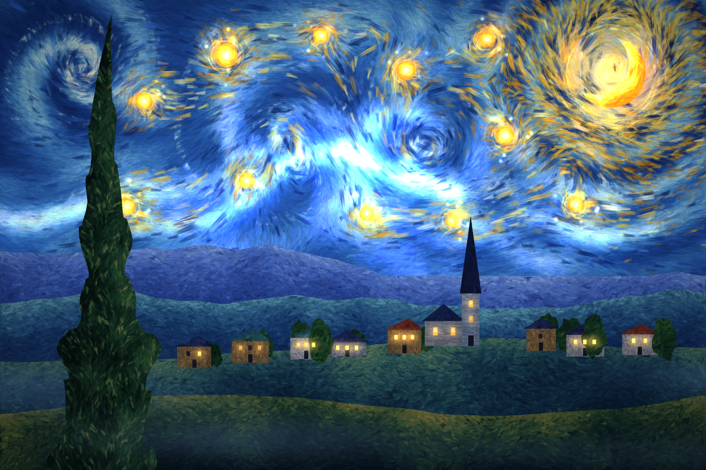
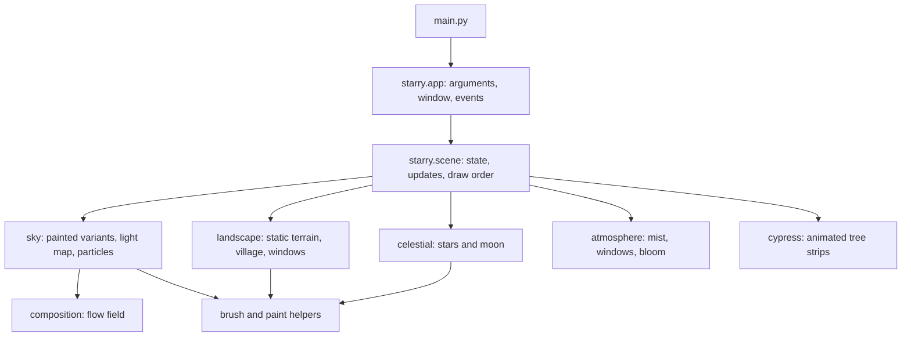

# The Starry Night — Living Painting

A real-time procedural painting inspired by Vincent van Gogh's 1889 *The Starry Night*. The desktop application generates its scene with Python, Pygame CE, and NumPy; it does not use a pre-rendered scene image or a network service.



## Contents

- [Overview](#overview)
- [Purpose](#purpose)
- [Features](#features)
- [Architecture](#architecture)
- [Technology](#technology)
- [Repository layout](#repository-layout)
- [Setup and usage](#setup-and-usage)
- [Configuration](#configuration)
- [Testing and validation](#testing-and-validation)
- [Security considerations](#security-considerations)
- [Limitations and status](#limitations-and-status)
- [License and credits](#license-and-credits)
- [Contributing](#contributing)
- [Documentation](#documentation)

## Overview

This project is an interactive generative-art application, rather than a web service or data-processing system. It builds a stylized night landscape from synthetic brush-stroke sprites and layers, then animates parts of the scene in a Pygame window. It demonstrates procedural image generation, vectorized numerical work, sprite caching, and a time-stepped animation loop.

## Purpose

The project explores how a static painting-inspired scene can be represented as procedural brushwork and brought to life through motion. Its goal is an interactive art and rendering demonstration, not solving a business or data-management problem.

## Features

- Builds a painted sky, mountain ridges, hills, village, church, foreground, and cypress tree procedurally.
- Creates synthetic brush strokes with bristle variation, dry-brush gaps, and cached rotations.
- Uses a sampled flow field with vortices and a curved band to guide sky strokes and moving particles.
- Animates three painted sky variants, stars, the moon, window lights, mist, and cypress strips.
- Offers a bloom effect and adjusts the number of active particles in response to recent frame time.
- Supports saving a rendered frame and running a simple frame-cost benchmark.

## Architecture

The application separates setup and input handling from scene composition and drawing. The scene creates a shared brush library and random-number generator, constructs the static and animated layers, and draws them in order each frame.



See [docs/ARCHITECTURE.md](docs/ARCHITECTURE.md) for component responsibilities and rendering order.

## Technology

- Python
- Pygame CE (imported as `pygame`)
- NumPy

The repository does not currently declare a supported Python version range. Installation and a headless render smoke test were verified in this environment with Python 3.14.7, Pygame CE 2.5.8, and NumPy 2.5.3.

## Repository layout

```text
.
|-- README.md
|-- preview.png
|-- docs/
|   |-- ARCHITECTURE.md
|   |-- DEVELOPMENT.md
|   `-- SRS.md
|-- .gitignore
`-- starry_night/
    `-- starry_night/
        |-- main.py
        |-- requirements.txt
        |-- tests/
        |   `-- test_app.py
        `-- starry/
            |-- app.py
            |-- scene.py
            |-- sky.py
            |-- landscape.py
            `-- ... other rendering modules
```

## Setup and usage

Run these commands from the repository root in PowerShell:

```powershell
python -m pip install -r .\starry_night\starry_night\requirements.txt
python .\starry_night\starry_night\main.py
```

The first run constructs the scene before opening the animation loop. The app creates a 1200 x 800 logical display and targets 60 frames per second; actual performance depends on the machine and display.

### Keyboard controls

| Key | Action |
| --- | --- |
| `Space` | Pause or resume animation |
| `Up` / `Down` | Increase or decrease animation speed |
| `G` | Toggle star, moon, and bloom glow |
| `F` | Toggle fullscreen |
| `R` | Reset animation state |
| `Esc` | Exit |

### Command-line options

```powershell
# Render and save a PNG after simulating 200 frames
python .\starry_night\starry_night\main.py --save-frame still.png --frames 200

# Report average and maximum measured frame cost
python .\starry_night\starry_night\main.py --bench --frames 300
```

`--frames` must be a positive integer. The saved frame and benchmark are generated locally; no files are uploaded.

## Configuration

The logical canvas size, target frame rate, random seed, and speed limits are defined as constants in `starry_night/starry_night/starry/config.py`. There are no required environment variables or separate configuration files.

## Testing and validation

Run the unit tests from the repository root:

```powershell
python -m unittest discover -s .\starry_night\starry_night\tests -t .\starry_night\starry_night
```

Run a short headless rendering smoke test (requires an SDL dummy video driver):

```powershell
$env:SDL_VIDEODRIVER = "dummy"
python .\starry_night\starry_night\main.py --save-frame smoke-test.png --frames 1
```

The smoke test writes `smoke-test.png` in the current directory. There is no configured formatter, static type checker, or separate lint command.

## Security considerations

The inspected application does not send data to a service, handle credentials, or keep persistent user state. Frame export writes to the path supplied by the user, so choose a destination with appropriate local permissions. Dependencies are third-party packages installed by pip; no formal security assessment has been performed.

## Limitations and status

- This is a local desktop application; it has no API, database, accounts, telemetry, installer, or deployment workflow.
- There are no automated visual-regression or interactive input tests. Keyboard controls and full-screen behavior have not been independently automated.
- The frame-time controller aims to adapt particle count; a fixed frame rate is not guaranteed.
- A minimum Python version and a formal support matrix have not been established.
- There is no `LICENSE` file, so the project's reuse and redistribution terms have not been specified. See [docs/DEVELOPMENT.md](docs/DEVELOPMENT.md) before proposing a license.

The implementation and a headless frame-render path were inspected and smoke-tested. This should not be read as a claim of production readiness or a formal security assessment.

## License and credits

The scene is procedurally generated and inspired by Vincent van Gogh's *The Starry Night* (1889). The existing `preview.png` is included as a visual preview. No project license is present, and no copyright holder has been established from the available repository information; therefore, this repository does not add a license.

## Contributing

Changes should preserve the existing procedural-rendering design and keep module responsibilities focused. Add or update tests for behavior changes, and run the unit tests and headless rendering command described above. No separate contribution guide or automated CI workflow is configured.

## Documentation

- [Software Requirements Specification](docs/SRS.md)
- [Architecture](docs/ARCHITECTURE.md)
- [Development guide](docs/DEVELOPMENT.md)
