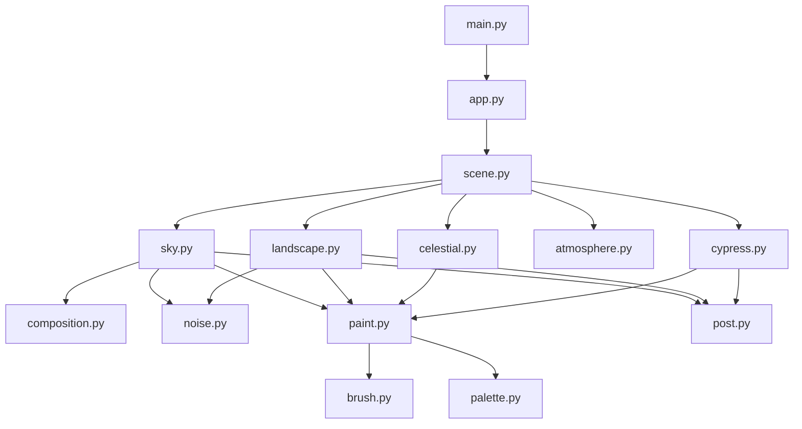

# Architecture

## Scope

The application is a single-process desktop renderer. It has no client/server split, persistent store, API, or external runtime service. The entry point initializes Pygame and delegates the application loop to `starry.app`.

## Component map

## Responsibilities

| Module | Responsibility |
| --- | --- |
| `main.py` | Calls the application entry point. |
| `starry/app.py` | Parses command-line options, initializes the display, handles keyboard events, and runs interactive, save-frame, or benchmark modes. |
| `starry/scene.py` | Constructs the scene layers, updates animation state, adapts the active-particle count, and coordinates draw order. |
| `starry/brush.py` | Generates procedural RGBA brush sprites and caches rotated variants. |
| `starry/paint.py` | Provides polygon painting, gradient/ramp selection, and surface conversion helpers. |
| `starry/sky.py` | Generates three static sky variants, the animated light map, and live brush-stroke particles. |
| `starry/composition.py` | Defines the flow field and the positions of the vortices, stars, moon, and curved sky band. |
| `starry/landscape.py` | Paints static landscape, village, church, windows, and separates the layer into sky-edge and opaque lower sections. |
| `starry/celestial.py` | Renders and animates stars and the moon. |
| `starry/atmosphere.py` | Draws mist and animated village windows and applies the sky bloom effect. |
| `starry/cypress.py` | Paints a cypress tree and animates it as horizontal strips. |
| `starry/noise.py` | Generates smooth one- and two-dimensional random fields using NumPy. |
| `starry/palette.py` | Defines interpolated color ramps. |
| `starry/post.py` | Applies a cached vignette and canvas-weave factor to static layers. |
| `starry/config.py` | Holds logical display, frame-rate, seed, and animation-speed constants. |

## Startup and rendering flow

1. `main.py` invokes `starry.app.run()`.
2. The app parses its options, initializes Pygame, creates a display, and constructs a `Scene`.
3. Scene construction creates a seeded NumPy random generator and a brush cache. It paints static terrain and sky, then prepares animated effects.
4. In interactive mode, each iteration advances time and particles, handles events, draws the scene, and flips the display.
5. In save-frame and benchmark modes, the app performs the requested number of simulation/draw iterations and exits. Save-frame mode writes a PNG to the requested local path.

The logical canvas is 1200 x 800. `pygame.SCALED` and `pygame.RESIZABLE` are requested; display creation retries with fewer flags if the platform does not support a requested mode.

## Render order

The scene draws these layers in this order:

1. Sky variants and animated light map
2. Live sky particles
3. Moon and stars
4. Bloom, when enabled
5. Painted landscape
6. Rear mist
7. Animated windows
8. Cypress
9. Foreground mist
10. Temporary status message

## State and determinism

The static composition is built once on startup. A fixed seed (`1889`) initializes the scene's NumPy generator, while animation uses elapsed simulation time. User controls change pause state, speed, glow, or reset the scene state. Reset does not rebuild the static layers.

## Constraints

- Scene geometry is authored for a fixed logical canvas; resizable display behavior is mediated by Pygame scaling rather than layout reflow.
- Scene construction is CPU-intensive and happens synchronously before the animation loop starts.
- Performance varies by machine. The particle controller adjusts the active count based on measured frame timing, but it does not guarantee a frame rate.
- The project has no installer, packaging metadata, continuous-integration workflow, or formal supported-platform matrix.
