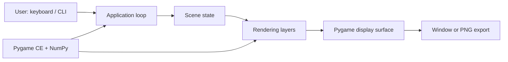

# Software Requirements Specification

## Document information

| Field | Value |
| --- | --- |
| Project | The Starry Night — Living Painting |
| Document | Software Requirements Specification |
| Version | 1.0 |
| Date | 2026-11-03 |
| Status | Draft; implementation-derived |

This specification describes the repository as inspected on the date above. Requirement statuses refer to source implementation, not a claim that every behavior has an automated test.

## 1. Introduction

### 1.1 Purpose

This document records the current functional and non-functional requirements for the procedural painting application. It is intended for maintainers, reviewers, and contributors.

### 1.2 Scope

The product is a local Python desktop application that procedurally generates and animates a night landscape inspired by Vincent van Gogh's 1889 painting *The Starry Night*. It renders through Pygame CE and uses NumPy for procedural geometry, noise, color selection, and particle updates. It does not provide a web service, persistent data store, network integration, or user account system.

### 1.3 Intended audience

- Users who want to run the interactive artwork.
- Developers maintaining or extending the rendering code.
- Reviewers evaluating the implementation and its documented limitations.

### 1.4 Definitions and acronyms

| Term | Definition |
| --- | --- |
| Bloom | Additive, multi-scale glow applied to a portion of the rendered sky. |
| Flow field | Sampled vector field used to orient brush strokes and move particles. |
| Logical canvas | The 1200 x 800 coordinate space used by scene layers. |
| Particle | A live, short-lived brush-stroke sprite in the sky. |
| Pygame CE | Community Edition distribution of Pygame; imported by the application as `pygame`. |

### 1.5 References

- Repository root [README](../README.md)
- [Architecture](ARCHITECTURE.md)
- [Development Guide](DEVELOPMENT.md)
- Application entry point: `starry_night/starry_night/main.py`

## 2. Overall description

### 2.1 Product perspective

The application is a single-process desktop program. The user starts it from Python; the program initializes Pygame, creates a window, constructs a procedural scene, and enters an event/update/render loop.

### 2.2 Product functions

- Generate a painted sky, landscape, village, church, moon, stars, and cypress.
- Animate selected layers and particles.
- Respond to keyboard controls for pause, speed, glow, fullscreen, reset, and exit.
- Save a rendered frame to a user-selected path.
- Report basic frame-cost measurements in benchmark mode.

### 2.3 User classes

| User class | Characteristics |
| --- | --- |
| Desktop user | Starts the program, views the animation, and uses the keyboard controls. |
| Developer | Installs dependencies, runs tests or diagnostic modes, and modifies Python modules. |

### 2.4 Operating environment

- Python runtime; the repository does not specify a supported version range.
- Pygame CE and NumPy installed from `requirements.txt`.
- A desktop operating system and a Pygame-supported display for interactive mode.
- A display driver is not required for automated/headless rendering when an SDL dummy video driver is available.

Python 3.14.7 on Windows was used for the dependency installation and headless render validation recorded for this revision.

### 2.5 Design and implementation constraints

- The logical canvas is fixed at 1200 x 800.
- Scene layers are generated synchronously during startup.
- Rendering and interaction depend on Pygame CE; numerical generation depends on NumPy.
- Scene content is generated in-process and is not persisted unless the user requests a frame export.

### 2.6 Assumptions and dependencies

- Python, Pygame CE, and NumPy are installable in the target environment.
- Interactive use has access to a Pygame-compatible display and keyboard.
- The user has write permission to the requested frame-export location.
- No external services, environment variables, or secrets are required by the inspected code.

## 3. System features

### SF-01: Procedural scene construction

- **Description:** Build sky, land, village, celestial objects, tree, and atmosphere from generated data and brush sprites.
- **Actor:** Application.
- **Preconditions:** Required Python packages are importable; Pygame is initialized before display-dependent scene construction.
- **Main workflow:** Create a seeded NumPy generator and brush library; build static and animated layers; prepare the scene for drawing.
- **Alternative workflow:** Display initialization retries with reduced window flags if the initial display request fails.
- **Postconditions:** Scene layers are available in memory for rendering.
- **Business rules:** The logical size and default seed come from `starry.config`.
- **Status:** Implemented; startup and one-frame rendering smoke-tested.

### SF-02: Interactive animation

- **Description:** Advance the scene and draw it repeatedly in a window.
- **Actor:** Desktop user.
- **Preconditions:** Scene construction completed and display initialized.
- **Main workflow:** Process events, update scene time and particles, draw layers, and present each frame.
- **Alternative workflow:** Pause freezes simulation time; speed controls adjust the time multiplier; glow controls toggle additive effects.
- **Postconditions:** The scene remains visible until the user exits or closes the window.
- **Business rules:** The loop targets the configured frame rate; actual performance is hardware- and environment-dependent.
- **Status:** Implemented; not interactively automated.

### SF-03: Keyboard interaction

- **Description:** Provide keyboard commands to control the running scene.
- **Actor:** Desktop user.
- **Preconditions:** Interactive mode is running.
- **Main workflow:** Handle `Space`, `Up`, `Down`, `G`, `F`, `R`, and `Esc` key presses.
- **Alternative workflow:** Fullscreen toggling returns the existing display surface if Pygame reports an error.
- **Postconditions:** Requested application state changes or the program exits.
- **Business rules:** Speed is clamped between the configured minimum and maximum.
- **Status:** Implemented in code; manual interaction remains unverified.

### SF-04: Frame export

- **Description:** Render a finite number of simulation frames and write the displayed surface to a PNG file.
- **Actor:** Developer or desktop user.
- **Preconditions:** Pygame and display initialization succeed; frame count is a positive integer; destination is writable.
- **Main workflow:** Run with `--save-frame PATH` and optionally `--frames N`; render the requested iterations and save the surface.
- **Alternative workflow:** With no `--frames` supplied, use the default count of 240.
- **Postconditions:** A PNG exists at the requested destination if saving succeeds.
- **Business rules:** The program reports the output path after a successful write.
- **Status:** Implemented; one-frame headless smoke-tested.

### SF-05: Frame benchmark

- **Description:** Measure per-frame update and drawing cost for a finite run.
- **Actor:** Developer or desktop user.
- **Preconditions:** Pygame and display initialization succeed; frame count is a positive integer.
- **Main workflow:** Run with `--bench` and optionally `--frames N`; print average and maximum timing from the latter half of the sample and active particle count.
- **Alternative workflow:** With no `--frames` supplied, use the default count of 240.
- **Postconditions:** Timing data is printed to standard output.
- **Business rules:** Measurements are diagnostic and do not imply a guaranteed frame rate.
- **Status:** Implemented; benchmark output not independently characterized across machines.

## 4. Functional requirements

| ID | Requirement | Status | Verification |
| --- | --- | --- | --- |
| FR-001 | The program shall initialize a Pygame display surface using a 1200 x 800 logical canvas. | Implemented | Headless render smoke test; window sizing behavior not tested on multiple displays. |
| FR-002 | The program shall construct a procedural sky and landscape without requiring a network connection or pre-rendered scene asset. | Implemented | Source inspection and headless render smoke test. |
| FR-003 | The scene shall draw sky, particles, moon, stars, optional bloom, landscape, mist, windows, cypress, and status text in the implemented order. | Implemented | Source inspection; smoke render completed. |
| FR-004 | Interactive mode shall update and draw frames until a quit event or Escape key is received. | Implemented | Source inspection; live interaction not automated. |
| FR-005 | `Space` shall toggle pause; Up and Down shall change speed within configured bounds. | Implemented | Source inspection; input events not automated. |
| FR-006 | `G` shall toggle glow, `F` shall request fullscreen toggling, and `R` shall reset scene animation state. | Implemented | Source inspection; input events not automated. |
| FR-007 | `--save-frame PATH` shall save a PNG after rendering the requested number of frames. | Implemented | One-frame headless PNG export completed. |
| FR-008 | `--bench` shall report average and maximum frame timing and the active particle count. | Implemented | Code inspected; zero-frame edge case reproduced and fixed by requiring a positive frame count. |
| FR-009 | `--frames` shall accept only positive integer values. | Implemented | Unit tests cover positive, zero, negative, and non-integer values. |
| FR-010 | The program shall exit without connecting to a network service or storing application state between runs. | Implemented | Source inspection; no network or persistent-storage modules found. |

## 5. Non-functional requirements

| ID | Requirement | Status | Notes |
| --- | --- | --- | --- |
| NFR-001 | The application shall target the configured 60 FPS limit during interactive rendering. | Implemented | A target is configured; achieved frame rate is not guaranteed. |
| NFR-002 | Scene generation and animation shall use bounded in-memory scene layers and particle arrays. | Implemented | Particle capacity is 2,800; peak memory use is not measured. |
| NFR-003 | The application shall keep generated artwork local unless the user explicitly saves a frame. | Implemented | No network or telemetry integration was found. |
| NFR-004 | The application shall provide keyboard controls and command-line help. | Implemented | Help output verified; keyboard behavior inspected in source. |
| NFR-005 | Runtime compatibility shall be declared for a tested Python version range. | Unverified | No support range is specified; Python 3.14.7 was exercised in this environment. |
| NFR-006 | The repository shall provide repeatable automated tests for command-line frame-count validation. | Implemented | `unittest` cases added for valid and invalid input. |
| NFR-007 | The repository shall define a platform-specific distribution/deployment procedure. | Unverified | No installer or deployment workflow exists. |
| NFR-008 | The application shall avoid handling credentials or personal data. | Implemented | No such data flows exist in inspected application code. |
| NFR-009 | The application shall provide a defined recovery or availability objective for local execution. | Unverified | No availability target or formal fault-recovery strategy is specified. |
| NFR-010 | The source shall remain separated into modules with documented responsibilities. | Implemented | Module boundaries and responsibilities are described in `ARCHITECTURE.md`. |
| NFR-011 | The keyboard interface shall be evaluated for accessibility, including non-keyboard access and visual contrast. | Unverified | No accessibility evaluation or alternative input path is documented. |
| NFR-012 | Rendering behavior shall scale to multiple users or concurrent workloads. | Unverified | The product is a single-user local desktop app; concurrency/scalability is not a defined use case. |
| NFR-013 | Exported image data shall be valid and readable as a PNG. | Implemented | A headless PNG was exported and verified by Pygame image loading. |

No security certification, accessibility conformance, cross-platform performance target, or availability guarantee is claimed. Persistent-data integrity requirements do not apply because the application stores no persistent application state.

## 6. External interface requirements

### 6.1 User interface

The UI is a Pygame-rendered window with keyboard input. The scene uses a 1200 x 800 logical canvas and requests scaled, resizable display flags, with fallback display modes if needed.

### 6.2 Software interfaces

- Pygame CE is installed as `pygame-ce` and imported as `pygame`.
- NumPy provides array computation and seeded random-number generation.
- No application API, database driver, external integration, or environment-variable interface is present.

### 6.3 Command-line interface

| Option | Behavior |
| --- | --- |
| `--save-frame PATH` | Save a rendered PNG and exit. |
| `--frames N` | Set a positive number of frames to simulate; default is 240. |
| `--bench` | Print frame timing data and exit. |

### 6.4 Output interface

Frame export writes a local PNG using Pygame's image saving support. The destination path and write permissions are controlled by the user.

## 7. Data requirements

### 7.1 Main entities

There are no persistent business entities. Runtime data consists of generated surfaces, color/geometry arrays, random generator state, animation state, and particle arrays.

### 7.2 Relationships

The `Scene` owns and coordinates its rendering layers. Layers share the brush library, seeded random generator during construction, and flow field as applicable. There is no database schema or inter-process data relationship.

### 7.3 Validation and constraints

- Frame counts are positive integers.
- Display geometry and scene coordinates use the configured logical canvas.
- Saved output must be writable at the user-provided path.

### 7.4 Retention

Runtime state is discarded when the process exits. Only explicitly exported images persist outside process memory.

## 8. System architecture

The program is a synchronous, single-process rendering loop. The app creates a `Scene`; the scene owns the sky, land, celestial, atmosphere, and cypress renderers. Shared low-level helpers provide brush generation, polygon painting, color ramps, smooth noise, flow sampling, and post-processing.

Detailed module responsibilities and draw order are documented in [ARCHITECTURE.md](ARCHITECTURE.md).

## 9. Use cases

### UC-01: View the animated painting

- **Actor:** Desktop user.
- **Preconditions:** Dependencies are installed and a compatible display is available.
- **Main scenario:** Start `main.py`; wait for scene construction; view the animation.
- **Alternative scenarios:** Pause, change speed, toggle glow/fullscreen, reset, or exit using keyboard shortcuts.
- **Expected result:** The scene is displayed and responds to supported controls.

### UC-02: Export a rendered frame

- **Actor:** Desktop user or developer.
- **Preconditions:** Dependencies and display initialization are available; destination is writable.
- **Main scenario:** Run with `--save-frame image.png`; optionally provide a positive `--frames` count.
- **Alternative scenarios:** An invalid frame count is rejected by command-line parsing before scene construction.
- **Expected result:** The program saves the displayed frame as a local PNG and exits successfully.

### UC-03: Measure rendering cost

- **Actor:** Developer.
- **Preconditions:** Dependencies and display initialization are available.
- **Main scenario:** Run with `--bench` and optionally a positive `--frames` count.
- **Alternative scenarios:** An invalid frame count is rejected before scene construction.
- **Expected result:** Average and maximum measured frame cost and active particle count are printed.

## 10. Constraints and limitations

- Rendering design is tied to a fixed logical coordinate system.
- Startup performs expensive scene generation synchronously.
- Performance adapts particle count but has no universal frame-rate guarantee.
- Visual correctness is not covered by automated image comparison.
- Platform support and Python support range are not formally specified.
- The repository has no package installer, release workflow, or CI configuration.
- No project license or copyright-holder confirmation is available in the repository.

## 11. Future requirements

The following items are proposals only and are not implemented requirements:

- Establish and test a supported Python and operating-system matrix.
- Add automated visual regression checks or deterministic image fixtures.
- Add a packaging and release workflow if distribution is desired.
- Evaluate keyboard navigation, contrast, and other accessibility concerns.
- Provide resize-aware scene layout if arbitrary logical resolutions are desired.
- Establish ownership and licensing terms before public redistribution.

## 12. Requirements traceability matrix

| Requirement | Feature | Relevant modules | Tests / evidence |
| --- | --- | --- | --- |
| FR-001 | SF-01 | `config.py`, `app.py` | Headless render smoke test |
| FR-002 | SF-01 | `scene.py`, `sky.py`, `landscape.py`, `brush.py` | Source inspection and headless render |
| FR-003 | SF-01, SF-02 | `scene.py` | Source inspection and headless render |
| FR-004 | SF-02, SF-03 | `app.py`, `scene.py` | Source inspection |
| FR-005 | SF-03 | `app.py`, `scene.py`, `config.py` | Source inspection |
| FR-006 | SF-03 | `app.py`, `scene.py` | Source inspection |
| FR-007 | SF-04 | `app.py` | Headless frame export |
| FR-008 | SF-05 | `app.py`, `scene.py` | Source inspection; zero-frame issue reproduced |
| FR-009 | SF-04, SF-05 | `app.py` | `tests/test_app.py` |
| FR-010 | SF-01 | Application modules | Repository source inspection |
| NFR-001 | SF-02 | `config.py`, `app.py`, `scene.py` | Config/source inspection; rate varies |
| NFR-002 | SF-01, SF-02 | `sky.py`, `scene.py` | Source inspection; memory not profiled |
| NFR-003 | All | Application modules | Source inspection |
| NFR-004 | SF-02, SF-03 | `app.py` | CLI help and source inspection |
| NFR-005 | All | `requirements.txt` | Python support matrix not declared |
| NFR-006 | SF-04, SF-05 | `app.py`, `tests/test_app.py` | Unit tests |
| NFR-007 | All | Repository configuration | No deployment workflow present |
| NFR-008 | All | Application modules | Source inspection |

## 13. Acceptance criteria

The current implementation satisfies the following acceptance checks in the verified environment:

1. Dependencies install from the repository requirements file with Python 3.14.7 on Windows.
2. The CLI help command loads successfully.
3. A one-frame headless run constructs the scene and writes a PNG successfully.
4. Unit tests reject zero, negative, and non-integer frame counts and accept a positive integer.
5. A zero-frame benchmark is rejected during argument parsing rather than failing during timing aggregation.

Cross-platform display behavior, interactive controls, accessibility, and performance outside the recorded environment remain unverified.
